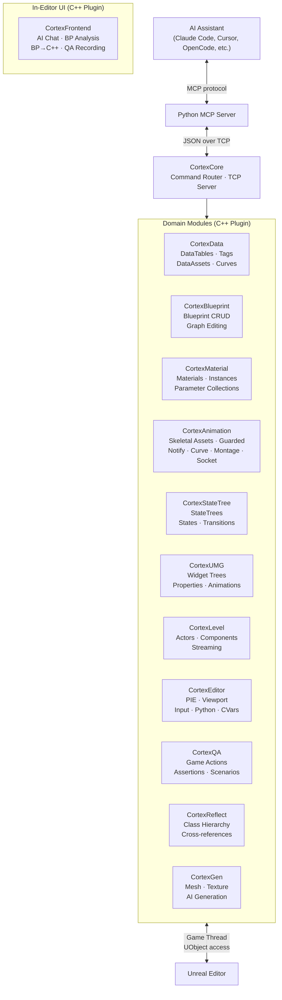

# UnrealCortex

<p align="center">
  
  
  
  
  
</p>

**Give your AI hands inside Unreal Engine.**

Your AI assistant can already write code. UnrealCortex lets it work *inside* the editor — querying DataTables, editing Blueprint graphs, building UMG hierarchies, placing actors, converting Blueprints to C++, analyzing Blueprints for bugs and performance issues, generating 3D assets, playing and testing your game autonomously, and replaying gameplay you recorded by hand, frame for frame. No copy-pasting, no file exports. Changes appear live with full undo support.

> **Status:** v0.4.5 Beta — All 15 modules shipped and tested.

---

## What AI Can Do

<details>
<summary><strong>Data — CortexData</strong> &nbsp;·&nbsp; 26 commands &nbsp;·&nbsp; DataTables, GameplayTags, DataAssets, CurveTables, StringTables</summary>

<br>

| Subsystem | Capabilities |
|-----------|-------------|
| **DataTables** | Query rows with wildcard filters, inspect schemas, add/update/delete rows, bulk import with dry-run, search across all tables, full CompositeDataTable awareness |
| **GameplayTags** | Browse tag hierarchies, validate tags, register new tags with auto `.ini` routing |
| **DataAssets** | List by class, inspect any property via reflection, partial field updates |
| **CurveTables** | Read time/value curves, modify keys |
| **StringTables** | Browse entries, update translations |
| **Asset Search** | Find any asset by name, class, or path |

Every mutation wrapped in `FScopedTransaction`. Large responses auto-truncate with metadata so the AI knows what it's working with.

**Example tasks:** *"Create a QuestRewards DataTable with columns for XP, Gold, and ItemID"* · *"Analyze all loot tables and flag rows where drop rate exceeds 15%"* · *"Add a new GameplayTag Quest.MainStory.Act2 and register it"* · *"Bulk-import 50 weapon definitions from this JSON into DT_Weapons"*

</details>

<details>
<summary><strong>Blueprint — CortexBlueprint + CortexGraph</strong> &nbsp;·&nbsp; Create, modify, compile, and migrate Blueprints</summary>

<br>

**Asset management:** Create, duplicate, delete, list Blueprints. Add variables with types, defaults, and categories. Add functions and events. Compile with error feedback via `FKismetCompilerContext`.

**Graph editing:** Traverse EventGraphs, function graphs, and macros via `UEdGraph`. Add and remove nodes. Connect pins with type-safe validation — mismatches return clear errors, not silent failures.

**Blueprint-to-C++ migration:** The AI reads the full Blueprint structure — variables, functions, graph nodes, pin connections — and generates equivalent C++ code. Combined with CortexReflect's class hierarchy awareness, it understands inheritance, overrides, and dependencies before writing a single line.

**Guarded retirement:** `graph.apply_patch` with `migration.op="retire_entries"` previews and removes explicitly reviewed obsolete entries and closed disconnected components. Closed orphan inventories additionally admit only exact `UK2Node_VariableGet`, `UK2Node_VariableSet`, `UK2Node_ExecutionSequence`, `UK2Node_Select` and `UK2Node_BreakStruct` classes, with class-owned resolved variables or a valid reflected struct. `source.entry_node_guids` may be omitted only for a nonempty explicit `source.orphan_component_node_guids`; a provided empty entry array and entryless additional-node selection refuse. External execution/data/delegate links, unresolved references and bound-graph owners refuse. Fingerprint/approval guards and compile/readback remain required; rollback preserves node indices and reciprocal pin-link enumeration, not just connectivity. The primary EventGraph is never deleted.

**Migration inspection and cleanup:** Byte-backed enum pin defaults retain their symbolic enum names rather than becoming integer zero. `blueprint.cleanup_migration` supports same-family native-parent migration for ordinary normal `UBlueprint`/`UBlueprintGeneratedClass` Object Blueprints as well as Actor, Component and Widget families; interfaces, specialized Blueprint families and cross-family targets refuse before mutation.

**Example tasks:** *"Convert BP_EnemyBase to a C++ class preserving all variables and function signatures"* · *"Create a BP_DoorInteractable with a boolean IsLocked variable and an Interact event"* · *"Wire up the OnOverlap event to toggle visibility and play a sound cue"*

</details>

<details>
<summary><strong>UI — CortexUMG</strong> &nbsp;·&nbsp; Build and modify UMG widget hierarchies</summary>

<br>

**Widget tree:** Traverse hierarchies, add/remove widgets, reparent within the tree. `umg.get_tree` returns a top-level whole-Widget-Blueprint `fingerprint` for tree operations; property-binding inspection retains its separate scoped fingerprint. Do not interchange the two guards.

**Properties:** Read and write any widget property — text, colors, visibility, padding, alignment. Schema introspection returns available properties for any widget class.

**Animations:** Create animations with stable Designer variable identities; inspect bindings and guardedly author float, `FLinearColor`, and `FSlateColor` tracks. Widget addition registers the actual UObject name through `OnVariableAdded`. Animation creation refuses widget/animation identity collisions and, only for a legacy empty GUID map, initializes all source-widget and existing-animation identities deterministically before registering the new animation; populated identities remain unchanged. Sections default to `RestoreState`; explicit `completion_mode: "KeepState"` preserves one-shot state effects. Completion mode accepts only those exact strings, not null, booleans or other names. Binding/track writes require fresh content fingerprints and separate preview/apply; compile and save explicitly.

**Example tasks:** *"Build a main menu with Play, Settings, and Quit buttons in a vertical box"* · *"Change the health bar color to red when below 25%"* · *"Add a fade-in animation to the game over screen"*

</details>

<details>
<summary><strong>Materials — CortexMaterial</strong> &nbsp;·&nbsp; Inspect and modify materials, instances, and parameter collections</summary>

<br>

**Asset management:** List, create, and delete materials and material instances. Duplicate existing materials as starting points.

**Parameters:** Read and write scalar, vector, and texture parameters on instances. Bulk-set multiple parameters in one call. Reset to parent defaults.

**Material graphs:** List expression nodes, inspect connections, add/remove nodes, wire them together.

**Parameter collections:** Create and manage material parameter collections — add, remove, and set collection parameters.

**Example tasks:** *"Create a glass material with adjustable opacity and refraction"* · *"Set all M_Wall instances to use the brick texture and tint them warm beige"* · *"Add a global TimeOfDay parameter collection and wire it to all outdoor materials"*

</details>

<details>
<summary><strong>Animation — CortexAnimation</strong> &nbsp;·&nbsp; Inspect skeletal assets and author guarded animation metadata</summary>

<br>

**Inspection:** List and inspect animation sequences, montages, skeletons, and Animation Blueprints without opening their editors. `anim.get_animbp_info` reports state machines, states, conduits and transitions with the `graph_guid` of each (read any nested graph with `graph.get_subgraph`), and opt-in `include` sections for anim-node bindings, function slots, property-access nodes, update-lifecycle thread safety and `AnimNotify_*` handler readiness.

**Guarded authoring:** Add, update, and remove sequence skeleton named notifies, editable float curves, montage sections, skeleton sockets, object notifies, and notify states. Every mutation requires a fresh `expected_fingerprint`, supports `dry_run`, and defaults `save` to `false`.

**Boundary:** Object notifies and notify states are sequence-only and use canonical selectors. The only Animation Blueprint mutation is `anim.rebind_function` (guarded function retarget, `dry_run` default `true`); variables move through `blueprint.adopt_native_member`. Blendspaces, retargeting, runtime preview, Sequencer, and Control Rig are not supported. There is no `anim.save_asset` command; use a mutation's `save=true` option, or `core.save_asset` where appropriate.

**Example tasks:** *"Inspect a montage's sections and slots"* · *"Dry-run a curve-key update using the current fingerprint"* · *"Add a socket to the hand bone, then save only after the preview is correct"*

</details>

<details>
<summary><strong>Level Design — CortexLevel</strong> &nbsp;·&nbsp; Actor placement, transforms, components, organization, streaming</summary>

<br>

**Actor lifecycle:** Spawn actors by class, delete, duplicate, rename. Set transforms (position, rotation, scale). Query bounding boxes.

**Discovery:** List all actors, find by class, tag, or name. Select actors programmatically.

**Components:** Add, remove, list components. Get and set any component property via reflection.

**Organization:** Assign actors to folders, set gameplay tags, group/ungroup, attach/detach hierarchies.

**Streaming:** List, load, and unload sublevels. Control sublevel visibility. Manage data layers.

**Batch:** `level_batch` composite command for multi-step scene construction in a single call.

**Example tasks:** *"Place 12 torches along the corridor with 300-unit spacing"* · *"Find all actors tagged 'Destructible' and move them into the Gameplay folder"* · *"Spawn a point light on every actor named 'Lamp*' and set intensity to 5000"*

</details>

<details>
<summary><strong>Editor Control — CortexEditor</strong> &nbsp;·&nbsp; PIE lifecycle, viewport, input injection, Python, CVars</summary>

<br>

**PIE lifecycle:** Start, stop, pause, resume, and restart Play-In-Editor sessions. Deferred cancellation is correlated with its start-request generation: late cleanup from a stopped session cannot terminate a newer start or its input/callback ownership. Duplicate cancellation coalesces to one owned deferred ticker; genuine current-request cancellation still reports termination and performs cleanup.

**Viewport:** Get and set editor-client camera position/rotation, capture the active viewport with explicit source/provenance, and switch render modes (including Lit + MeshEdges wire overlay). Possessed PIE rejects editor-camera movement by default; `allow_during_pie: true` changes only the transient editor client, not the game camera. Game captures do not invent camera poses; ejected/SIE editor views remain controllable.

**Input injection:** Press keys or inject typed Enhanced Input values using canonical `action_name` and a scalar or `{x,y,z}`. Single-shot and timed sequences share validation. `inject_input_continuous` supports immediate start/update/stop and deferred positive `duration_ms` starts. Ownership follows the actual subsystem/action pair; stop, PIE teardown, owner destruction, and any client disconnect cancel Cortex-owned runs. Ownership is session-wide, not per-client isolation; game-managed injection is not stopped by an unowned Cortex stop, and already queued input may drain afterward.

**Mouse input:** `inject_mouse` requires `action: "click"`, `"move"` or `"scroll"`. Optional `x`/`y` are screen-space coordinates; omitted coordinates use the current cursor position. Click defaults to `button: "left"` (also `"right"`/`"middle"`); scroll requires numeric `delta`. This operation has no `duration_ms` contract. Its `dispatched` result reports Slate event dispatch, not proof that the intended gameplay UI target handled a click.

**Editor management:** Execute console commands. Adjust time dilation. Shutdown/restart editor.

**Diagnostics:** Query world info, viewport state, recent log output, and editor-wide console variables.

**Trusted Python:** `run_python` executes local Unreal Editor Python through `editor_cmd` as a high-trust escape hatch. Prefer structured Cortex commands first; Python can mutate assets/files, import content, call editor APIs, and trigger project-specific side effects. Output and error detail payloads are bounded before JSON serialization.

**CVars:** `get_cvar`, `set_cvar`, and `list_cvars` inspect or adjust editor console variables outside PIE. Listings are capped, sorted by name, and split console variables from console commands.

**Example tasks:** *"Start PIE, take a screenshot of the main menu, then stop"* · *"Move the viewport camera to the boss arena and capture a top-down shot"* · *"Set time dilation to 0.25 so I can debug the dash animation"* · *"List render CVars matching r.Nanite and temporarily set one for editor diagnostics"* · *"Run a trusted editor Python snippet to inspect an API that Cortex does not expose yet"*

</details>

<details>
<summary><strong>Gameplay QA — CortexQA</strong> &nbsp;·&nbsp; Play-test your game through structured scenarios</summary>

<br>

**World queries:** List actors with details, inspect specific actors and the player character at runtime.

**Game actions:** Move the player to locations, interact with objects, look at targets, teleport.

**Assertions:** Assert game state conditions, wait for conditions with timeout, record named test steps.

**Scenario engine:** `run_scenario_inline` executes multi-step test sequences — move here, interact with that, verify this state — in a single declarative call.

**Reproducibility:** Set random seed for deterministic test runs.

**Example tasks:** *"Walk to the shop NPC, interact, and verify the shop menu opens"* · *"Run a full playthrough: spawn, pick up the sword, enter the dungeon, kill the first enemy"* · *"Assert that the player's health drops after stepping on the lava tile"*

</details>

<details>
<summary><strong>Recorded Gameplay Replay — CortexReplay</strong> &nbsp;·&nbsp; Record real input in PIE, let AI replay it frame-exactly</summary>

<br>

**Record:** In the **Cortex Replay** window a human records a PIE session: real keyboard and mouse input (keys, buttons, pointer and raw mouse motion, wheel) together with every engine frame's time step, the starting map, the player pose and the viewport/input prerequisites. Stopping PIE with its own stop key ends and saves the recording. The list shows each recording's ID, name, map, length and recording date (local time; the exact UTC time is in the tooltip), and whether AI may use it.

**Replay:** Replay starts a fresh PIE on the recorded map, restores the recorded start pose, then dispatches each recorded frame on exactly one engine frame with that frame's recorded delta. Movement and look therefore integrate exactly as they did when recorded. No custom engine and no custom time step are needed, so it runs on a stock engine.

**Hands-off countdown and interruption notice:** Every replay, human- or AI-started, shows a 3·2·1 "don't touch the mouse or keyboard" countdown on the game view, then a "Replaying…" banner while it plays. Turn the countdown off per recording in the Edit dialog ("Countdown before replay") when the game needs input or events in its first seconds. If you touch the mouse or keyboard or the game window loses focus, the replay stops and an editor toast says why ("Replay stopped: you pressed W") and where (time and frame), with **Replay again**. Engine-driven cursor moves (for example a game showing its cursor) no longer count as your input.

**AI access:** AI can only replay recordings a human has enabled, through `replay_cmd` (`list_recordings`, `get_recording`, `start_replay`, `get_run`, `cancel_replay`). Every key/button press is guarded against pose drift; a drifted pose, a changed time step or a prerequisite mismatch ends the run with a structured error instead of playing on. A finished run reports frame and event counts and the recording digests, so an agent can verify that the recording still replays faithfully. Replay has no gameplay assertions; combine it with QA when you need a pass/fail.

**Example tasks:** *"Which recordings can you replay, and how long are they?"* · *"Validate that recording 3 still replays after my movement changes"* · *"Replay TestRoomAround and report any drift"*

</details>

<details>
<summary><strong>AI State Machines — CortexStateTree</strong> &nbsp;·&nbsp; StateTree assets, state hierarchy, transitions, validation, compile</summary>

<br>

**Asset lifecycle:** List, create, duplicate, delete, and save StateTree assets with referencer checks and stale-write fingerprints.

**Inspection:** Dump full StateTree structure, read individual states by GUID or path, and run read-only structure checks for missing editor data, ambiguous paths, duplicate IDs, and dangling transitions.

**Authoring:** Add, remove, rename, move, and configure states. Add and update simple transitions with trigger, priority, target, and Gameplay Tag validation.

**Validation and compile:** Run mutating StateTree validation fixups and explicit compile with structured diagnostics. `statetree_compose` creates or updates multi-state structures with fingerprint threading and cleanup on create failure.

**Node migration:** `statetree.get_node_bindings` reports every stored property binding per node (source and target, with resolved paths and property GUIDs); `statetree.replace_node` swaps a Blueprint task, condition, evaluator or consideration for a native one in place, keeping the editor node ID so every binding survives, and refuses rather than drops a binding (UE 5.8+, `NOT_AVAILABLE` below). `statetree.get_runtime_state` reports the running components of the PIE world.

**Current boundary:** Structure-level authoring plus Blueprint-to-native node replacement. Arbitrary task, condition, evaluator, parameter bag, and property binding authoring are intentionally not exposed; a replacement swaps data and bindings, never logic.

**Example tasks:** *"Create ST_Guard with Patrol and Chase states and a SawTarget transition"* · *"Review all StateTrees for dangling transitions and invalid tags"* · *"Compile ST_BossBehavior and summarize diagnostics"*

</details>

<details>
<summary><strong>Project Analysis — CortexReflect</strong> &nbsp;·&nbsp; Class hierarchy, properties, cross-references, migration intelligence</summary>

<br>

**Project scanning:** Build a class hierarchy cache from loaded C++ modules and Blueprint assets.

**Class queries:** Query any class for its properties, functions, metadata, and parent chain. Full context (self + parent + children) in one call.

**Hierarchy navigation:** Walk the class tree across C++ and Blueprint boundaries.

**Override detection:** Find which Blueprint classes override specific C++ base functions.

**Usage search:** Search for references to a class across all loaded Blueprint assets.

**Migration intelligence:** Before converting a Blueprint to C++, the AI uses Reflect to understand the full picture — what the class inherits, which functions it overrides, what other Blueprints reference it — so the generated C++ is correct and nothing breaks downstream.

**Example tasks:** *"Show me all Blueprint classes that inherit from ABaseEnemy"* · *"Which Blueprints override the TakeDamage function?"* · *"Analyze BP_InventorySystem dependencies before I migrate it to C++"*

</details>

<details>
<summary><strong>AI Asset Generation — CortexGen</strong> &nbsp;·&nbsp; Generate 3D meshes and textures from text or image prompts</summary>

<br>

**Mesh generation:** Submit text or image prompts to Meshy or Tripo3D via `gen.start_mesh`. Supports text-only, image-only, and combined text+image reference (Meshy). Results auto-import as `UStaticMesh` assets.

**Texturing:** Apply AI texturing to existing 3D models using a text or image prompt via `gen.start_texturing` (Meshy only).

**Async job lifecycle:** Jobs progress through `pending → processing → complete → downloading → importing → imported`. Poll with `gen.job_status` for progress (0.0–1.0) and imported asset paths. `download_failed` and `import_failed` states are retryable without re-generating.

**Job management:** List all jobs (filterable by status), cancel in-flight jobs, delete history entries. Job state persists across editor sessions in `Saved/CortexGen/Jobs.json`.

**Provider selection:** Choose provider per job or rely on the configured default. `gen.list_providers` returns registered providers and their capabilities.

**Generate tab:** `SCortexGenTab` in the CortexFrontend workbench provides a GUI for level designers — prompt input, provider selection, job queue with progress bars, and result preview.

**Configuration:** API keys and import destinations set in Project Settings > Plugins > Cortex Gen. Keys stored in `EditorPerProjectUserSettings.ini` (gitignored — never in version control).

**Example tasks:** *"Generate a moss-covered stone pillar mesh from this concept art"* · *"Create a sci-fi crate using a text description and import it to /Game/Generated/Meshes"* · *"Apply stylized cartoon texturing to SM_RockFormation using Meshy"* · *"List all in-progress generation jobs and their current progress"*

</details>

<details>
<summary><strong>In-Editor AI UI — CortexFrontend</strong> &nbsp;·&nbsp; Blueprint analysis, BP-to-C++ conversion, QA recording</summary>

<br>

**AI Chat:** Dockable panel with persistent Claude CLI session, streaming responses, tool activity display, and three access modes (ReadOnly, Guided, FullAccess).

**Blueprint Analysis:** AI-powered Blueprint review triggered from the editor toolbar. Configurable analysis depth (Quick Overview, Standard, Deep Dive) with UE safety pattern awareness that prevents false positives (validated casts, IsValid macros, multi-hop exec flow). Findings appear with severity-colored expandable detail sections, suggested fixes, and direct "Open in BP" navigation. Token budget management with per-function estimates.

**Blueprint-to-C++ Conversion:** Dual-pane workspace with chat panel and code canvas. AI generates C++ header + implementation from Blueprint structure. Follow-up modifications use search/replace diffs with visual diff rendering and one-click apply.

**QA Recording:** Session recording and replay for gameplay test automation.

**Example tasks:** *"Analyze BP_EnemyBase for bugs and performance issues"* · *"Convert BP_InventoryManager to C++"* · *"Record a playthrough of the tutorial level"*

</details>

---

## Architecture



Commands are namespaced: `{domain}.{command}` — e.g. `data.query_datatable`, `bp.create`, `graph.add_node`. CortexCore routes each command to its registered domain handler and dispatches to the Game Thread. The port is auto-discovered via `Saved/CortexPort-{PID}.txt` — multiple editor instances each get their own port.

Representative command examples include `data.query_datatable`, `bp.create`, `graph.add_node`, `anim.get_sequence_info`, `anim.add_curve`, `statetree.dump_tree`, `statetree.add_state`, and `statetree.compile`.

---

## Quick Start

### Requirements

- Unreal Engine 5.6+
- Python 3.10+ with [uv](https://docs.astral.sh/uv/) (`pip install uv` or see [uv docs](https://docs.astral.sh/uv/getting-started/installation/))
- An MCP-compatible AI assistant ([Claude Code](https://docs.anthropic.com/en/docs/claude-code), Cursor, OpenCode, etc.)

### Step 1 — Install the Plugin

Create the `Developer` folder if it doesn't exist, then install using one of the two methods below.

#### Option A — Git Submodule *(recommended for version-controlled projects)*

```bash
mkdir -p YourProject/Plugins/Developer
cd YourProject/Plugins/Developer
git submodule add https://github.com/etelyatn/UnrealCortex.git UnrealCortex
```

#### Option B — Manual Download

1. Go to [github.com/etelyatn/UnrealCortex](https://github.com/etelyatn/UnrealCortex)
2. Click **Code → Download ZIP** (or download a tagged release from the [Releases](https://github.com/etelyatn/UnrealCortex/releases) page)
3. Extract the contents so the folder structure is:
   ```
   YourProject/
   └── Plugins/
       └── Developer/
           └── UnrealCortex/
               ├── Source/
               ├── MCP/
               └── UnrealCortex.uplugin
   ```

#### After Either Method

Add the plugin to your `.uproject`:

```json
{
  "Plugins": [
    { "Name": "UnrealCortex", "Enabled": true }
  ]
}
```

Rebuild your project. All 14 modules load automatically at `PostEngineInit` — after `IAssetRegistry` and the Blueprint compilation system are ready. All modules are `Type: Editor` and are stripped from shipping builds.

### Step 2 — Install Python Dependencies

```bash
cd Plugins/Developer/UnrealCortex/MCP
uv sync
```

### Step 3 — Connect Your AI Assistant

Choose one of the two installation paths below.

#### Option A — Automatic Setup with Cortex Toolkit *(Claude Code, Codex, Cursor, OpenCode)*

> [!NOTE]
> **[Cortex Toolkit](https://github.com/etelyatn/cortex-toolkit)** adds domain-specific skills and project memory on top of UnrealCortex. It handles MCP configuration, editor auto-launch, and context injection automatically.

**Install the toolkit:**

Claude Code:

```bash
claude plugin marketplace add etelyatn/cortex-toolkit
claude plugin install cortex-toolkit
```

Codex:

```bash
codex plugin marketplace add etelyatn/cortex-toolkit
codex plugin add cortex-toolkit@cortex-toolkit
```

Then restart Codex if it was already running.

OpenCode:

Run `cortex-setup` in your project and select OpenCode when asked which assistants to configure. This writes the `plugin` and `cortex_mcp` MCP entries into `opencode.json`. See the [Cortex Toolkit README](https://github.com/etelyatn/cortex-toolkit) for details.

Then restart OpenCode if it was already running.

For Cursor setup, see the [Cortex Toolkit README](https://github.com/etelyatn/cortex-toolkit).

**Start the assisted workflow** — run `/cortex-setup` (or `cortex-setup` in Codex/OpenCode) first. It handles onboarding, project initialization, schema refresh, and next-step guidance, and routes editor/MCP lifecycle work to `cortex-editor`.

If you want only setup without the full guided flow, run `/cortex-setup` (or `cortex-setup`) directly. It will:

1. Detect your Unreal Engine installation
2. Scan the plugin for enabled domain modules
3. Create `.mcp.json` with the correct MCP server configuration
4. Set up `.cortex/` project memory directory with domain knowledge templates

After init, use `cortex-setup` to regenerate `.cortex/schema/` from live editor data and to get contextual next-step suggestions. Codex and OpenCode users can also configure `.mcp.json` manually using Option B below; the toolkit plugin supplies skills and setup guidance while the project-local MCP config supplies the live UnrealCortex connection.

#### Option B — Manual Setup *(Cursor, Windsurf, or any MCP client)*

Create `.mcp.json` at your project root. Both paths must be **absolute** — relative paths fail when the MCP client's working directory doesn't match your project root, which is the default for most clients.

```json
{
  "mcpServers": {
    "cortex_mcp": {
      "command": "uv",
      "args": ["run", "--directory", "D:/UnrealProjects/YourProject/Plugins/Developer/UnrealCortex/MCP", "cortex-mcp"],
      "env": { "CORTEX_PROJECT_DIR": "D:/UnrealProjects/YourProject" }
    }
  }
}
```

To get the correct absolute path, run this from your project root:

```bash
uv run python -c "import os; print(os.path.abspath('.').replace(chr(92), '/'))"
```

That prints your project root. Append `/Plugins/Developer/UnrealCortex/MCP` (adjust the subfolder if your install path differs) for the `--directory` value.

Open your project in the Unreal Editor. CortexCore writes `Saved/CortexPort-{PID}.txt` on startup (one per editor instance) — the MCP server discovers it automatically. If the editor is not open, MCP tool calls will return an `EDITOR_NOT_RUNNING` error. If you restart the editor, the MCP server picks up the new port file automatically. Multiple editors can run simultaneously — each gets its own port.

---

## Project Memory

> [!IMPORTANT]
> Cortex Toolkit creates a `.cortex/` directory in your project root. Fill it with your project's conventions — table schemas, Blueprint naming rules, material hierarchies, screen inventory. Instead of explaining your conventions in every chat, write them once and every agent respects them automatically.

The session-start hook injects `context.md` automatically. Domain agents read their specific file (e.g., `domains/blueprints.md`) before every task.

```
.cortex/
├── config.yaml          ← shared engine defaults, active domains
├── config.local.yaml    ← optional per-machine overrides, not committed
├── context.md           ← shared project knowledge (read every session)
└── domains/
    ├── data.md          ← table schemas, balance rules
    ├── blueprints.md    ← class hierarchy, conventions
    ├── material.md      ← material conventions, instance hierarchies
    ├── statetree.md     ← state hierarchy, transitions, validation rules
    ├── umg.md           ← screen inventory, style guide
    ├── level.md         ← actor conventions, level structure
    ├── qa.md            ← test scenarios, assertion patterns
    ├── reflect.md       ← class hierarchy notes, scan scope
    └── gen.md           ← generation providers, import destinations, job patterns
```

Check `.cortex/config.yaml` into version control for shared project defaults. Put workstation-specific values, especially a local Unreal Engine install path, in `.cortex/config.local.yaml`. Cortex Toolkit merges the local file over the shared config when present, and editor helpers fall back to `UE_PATH` only when the effective Cortex config has no `engine.path`.

---

## Architecture Deep Dive

<details>
<summary>Threading · Undo/Redo · Extensibility · Cook Safety</summary>

<br>

### Threading Model

The TCP server runs on a dedicated `FRunnable` thread and shuts down cleanly in `ShutdownModule()`. All UObject access dispatches to the Game Thread:

```cpp
AsyncTask(ENamedThreads::GameThread, [Command, Params, Callback]()
{
    FCortexCommandResult Result = Handler->Execute(Command, Params, Callback);
});
```

Domain module authors do not manage threading. CortexCore handles dispatch before invoking any `ICortexDomainHandler`.

### Undo / Redo

Every write operation is wrapped in `FScopedTransaction`:

```cpp
FScopedTransaction Transaction(
    FText::FromString(FString::Printf(TEXT("Cortex: %s"), *CommandName))
);
// ... mutation ...
```

Standard Ctrl+Z / Ctrl+Y undo works on all AI-driven changes.

### Extending with a Custom Domain

Implement `ICortexDomainHandler` and register at module startup:

```cpp
// The interface contract
virtual FCortexCommandResult Execute(
    const FString& Command,
    const TSharedPtr<FJsonObject>& Params,
    FDeferredResponseCallback DeferredCallback = nullptr  // optional: for async responses
) = 0;

virtual TArray<FCortexCommandInfo> GetSupportedCommands() const = 0;  // drives get_capabilities
```

```cpp
void FMyDomainModule::StartupModule()
{
    auto& Registry = FModuleManager::GetModuleChecked<ICortexCoreModule>("CortexCore")
        .GetCommandRegistry();

    Registry.RegisterDomain(
        TEXT("mydomain"), TEXT("My Domain"), TEXT("1.0.0"),
        MakeShared<FMyDomainCommandHandler>()
    );
}
```

`GetSupportedCommands()` feeds the `get_capabilities` built-in command — the AI can discover what your domain exposes automatically. Drop Python tools into `MCP/tools/mydomain/` and they are discovered at server start with no registration boilerplate.

### Module Dependencies

| Module | Depends On | Key UE Engine Modules |
|--------|-----------|----------------------|
| **CortexCore** | — | `Sockets` · `Networking` · `Json` · `JsonUtilities` · `GameplayTags` · `UnrealEd` · `AssetRegistry` |
| **CortexGraph** | CortexCore | `BlueprintGraph` · `KismetCompiler` · `UnrealEd` |
| **CortexBlueprint** | CortexCore · CortexGraph | `BlueprintGraph` · `Kismet` · `KismetCompiler` · `AssetRegistry` · `GameplayTags` |
| **CortexMaterial** | CortexCore · CortexGraph | `MaterialEditor` · `AssetRegistry` |
| **CortexData** | CortexCore | `GameplayTags` · `AssetRegistry` · `UnrealEd` |
| **CortexEditor** | CortexCore | `LevelEditor` · `Slate` · `SlateCore` · `EnhancedInput` · `ImageWrapper` · `RenderCore` · `PythonScriptPlugin` |
| **CortexQA** | CortexCore · CortexEditor | `NavigationSystem` · `AIModule` · `GameplayTags` |
| **CortexStateTree** | CortexCore | `CoreUObject` · `Engine` · `Json` · `JsonUtilities` · `AssetRegistry` · `AssetTools` · `UnrealEd` · `GameplayTags` · `StateTreeModule` · `StateTreeEditorModule` · `AIModule` · `BlueprintGraph` · `Kismet` |
| **CortexLevel** | CortexCore | `LevelEditor` · `DataLayerEditor` |
| **CortexUMG** | CortexCore | `UMG` · `UMGEditor` · `Slate` · `SlateCore` · `MovieScene` |
| **CortexReflect** | CortexCore | `AssetRegistry` · `BlueprintGraph` · `Kismet` · `UMG` |
| **CortexGen** | CortexCore | `HTTP` · `Json` · `JsonUtilities` · `AssetTools` · `DeveloperSettings` · `ImageWrapper` · `UnrealEd` |
| **CortexAnimation** | CortexCore · CortexGraph (shared infrastructure) | `CoreUObject` · `Engine` · `Json` · `JsonUtilities` · `UnrealEd` · `AssetRegistry` · `AnimGraph` · `BlueprintGraph` · `Kismet` · `SlateCore` |
| **CortexFrontend** | CortexCore · CortexGen | `Slate` · `SlateCore` · `GraphEditor` · `BlueprintGraph` · `Kismet` · `ImageWrapper` · `EditorScriptingUtilities` · `DesktopPlatform` |
| **CortexReplay** | CortexCore · CortexEditor | `Slate` · `SlateCore` · `InputCore` · `UnrealEd` · `LevelEditor` · `ToolMenus` · `Json` |

Domain modules depend only on CortexCore (and shared infrastructure: CortexGraph, CortexEditor). Never on each other. CortexFrontend is a UI leaf module with no MCP command surface.

### Cook and Packaging Safety

All 15 modules declare `"Type": "Editor"` in `UnrealCortex.uplugin`. Because `Type: Editor` modules are not loaded in non-editor targets (cook, server, game), the `PostEngineInit` load phase is only relevant in the editor. The plugin is never included in cooked or packaged builds.

### Generic Serialization

`FCortexSerializer` uses Unreal's property system (`FProperty*`, `UStruct*`) to convert any UStruct to JSON. Domain modules focus on logic, not formatting — they never write JSON manually.

`FCortexSerializer::PropertyDifferenceToJson` serializes the recursive difference between a value and an inherited baseline. Identical values produce no value at all, structs of the same type are compared member by member so equal members are omitted, and arrays, sets, maps, object identities and scalars are compared whole and serialized atomically. A comparison that exhausts its depth budget reports a structured issue and a partial result instead of a sentinel value. The caller owns the baseline's identity, so a caller never reads one instance's fields through another instance's layout. Blueprint's `get_class_defaults` uses it for `changed_only=true` (which requires `include_values=true` and refuses `include_members`, because that describes effective members rather than deltas): the response declares `value_mode=inherited_delta` and `baseline_class`, sets `effective_values_complete=false`, lists equal-to-baseline roots under `omitted_equal_properties`, and reports subclass-owned roots (which have no inherited baseline) as their own effective values. Only a complete and truly equal comparison is ever listed as an omission: a root whose comparison could not be completed (for example a struct chain deeper than the comparison depth) is reported as an entry flagged `incomplete` that carries its own `issues` and no `value`, and the echo declares `echo_complete=false`. A value is presented only when the serialization produced a usable one, so a truncated or unsupported comparison never has its null placeholder or an effective value passed off as the delta value.

### Hot Reload

After a Live Coding recompile, the TCP server restarts automatically with the new module. If reconnection fails, restarting the editor restores the connection.

</details>

---

## Known Limitations

These are the current boundaries of the beta. They're on the roadmap but not yet resolved:

- **Widget animation track scope:** Guarded authoring supports ordinary named Designer widgets with float/linear-color/Slate-color tracks and linear/constant keys. Root user-widget, slot/dynamic bindings, object/bool/custom tracks, double and cubic interpolation remain unsupported.
- **Blueprint compile diagnostics:** `bp.compile` returns success/failure with structured diagnostics, but error-to-node mapping depends on compiler message format consistency
- **Concurrent input sequences:** `run_input_sequence` works correctly for single-agent use; concurrent sequences from multiple agents may route callbacks incorrectly
- **Reflect coverage:** `query_class_hierarchy` and `find_usages` only see Blueprint classes loaded in memory; unloaded Blueprints are silently skipped
- **Batch pipeline:** No transactional rollback; if a batch step fails, completed steps are not undone

---

## What's Next

| Domain | What AI will be able to do |
|--------|---------------------------|
| **CortexNiagara** | Modify particle system parameters, emitter configuration |

---

## License

MIT

## Author

Eugene Telyatnik — [@etelyatn](https://github.com/etelyatn)
